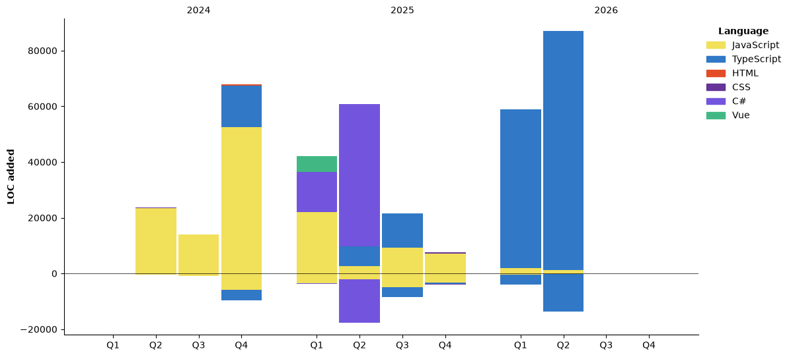

<div align="left">
  <p>👋 Hi, I am Brielle</p>
  <p>🔥 A passionate Front-end Web Developer</p>
  <p>💻 Open to collaboration and hiring opportunities</p>
  <p>📬 You can reach me at <strong>chukwuemerieclara@gmail.com</strong></p>
</div>


 
 <!--START_SECTION:waka-->


**I'm an Early 🐤** 

```text
🌞 Morning                225 commits         ████████░░░░░░░░░░░░░░░░░   30.04 % 
🌆 Daytime                275 commits         █████████░░░░░░░░░░░░░░░░   36.72 % 
🌃 Evening                111 commits         ████░░░░░░░░░░░░░░░░░░░░░   14.82 % 
🌙 Night                  138 commits         █████░░░░░░░░░░░░░░░░░░░░   18.42 % 
```
📅 **I'm Most Productive on Thursday** 

```text
Monday                   112 commits         ████░░░░░░░░░░░░░░░░░░░░░   14.95 % 
Tuesday                  81 commits          ███░░░░░░░░░░░░░░░░░░░░░░   10.81 % 
Wednesday                112 commits         ████░░░░░░░░░░░░░░░░░░░░░   14.95 % 
Thursday                 124 commits         ████░░░░░░░░░░░░░░░░░░░░░   16.56 % 
Friday                   108 commits         ████░░░░░░░░░░░░░░░░░░░░░   14.42 % 
Saturday                 100 commits         ███░░░░░░░░░░░░░░░░░░░░░░   13.35 % 
Sunday                   112 commits         ████░░░░░░░░░░░░░░░░░░░░░   14.95 % 
```


📊 **This Week I Spent My Time On** 

```text
🕑︎ Time Zone: Africa/Abidjan

💬 Programming Languages: 
Markdown                 10 hrs 6 mins       ██████████░░░░░░░░░░░░░░░   40.87 % 
Java                     9 hrs 19 mins       █████████░░░░░░░░░░░░░░░░   37.69 % 
XML                      3 hrs 38 mins       ████░░░░░░░░░░░░░░░░░░░░░   14.71 % 
C#                       51 mins             █░░░░░░░░░░░░░░░░░░░░░░░░   03.46 % 
TypeScript               16 mins             ░░░░░░░░░░░░░░░░░░░░░░░░░   01.09 % 

🔥 Editors: 
Claude Code              19 hrs 16 mins      ███████████████████░░░░░░   77.86 % 
VS Code                  5 hrs 28 mins       ██████░░░░░░░░░░░░░░░░░░░   22.14 % 

🐱‍💻 Projects: 
solvepx-corp-api         21 hrs 44 mins      ██████████████████████░░░   87.87 % 
solvesource              2 hrs 12 mins       ██░░░░░░░░░░░░░░░░░░░░░░░   08.96 % 
solvepx-muni-api         47 mins             █░░░░░░░░░░░░░░░░░░░░░░░░   03.17 % 

💻 Operating System: 
Windows                  24 hrs 44 mins      █████████████████████████   100.00 % 
```

🤖 **AI Coding This Week** 

```text
⏱ AI Coding Time: 21 hrs 14 mins (85.83%)

✍️ 18,741 lines written by AI, 345 lines written by hand (98.19% AI-written)

🔤 8,846,194 Input Tokens, 969,465 Output Tokens

💵 $91.07 Estimated AI Cost This Week

🧠 39 AI Sessions, 276 AI Prompts

Sonnet                   19,656 lines        █████████████████████████   100.00 % 

🔎 AI Coding Insights:
🤖 AI-Driven — 98.19% of written lines came from AI
📚 Verbose Prompter — average 3,054 characters per prompt
🔁 Iterative Prompter — average 7 prompts per session
🚀 High AI Trust — 2.6% of changed lines were hand-edited
```

**I Mostly Code in JavaScript** 

```text
JavaScript               17 repos            ████████████░░░░░░░░░░░░░   48.57 % 
TypeScript               10 repos            ███████░░░░░░░░░░░░░░░░░░   28.57 % 
C#                       4 repos             ███░░░░░░░░░░░░░░░░░░░░░░   11.43 % 
Vue                      1 repo              █░░░░░░░░░░░░░░░░░░░░░░░░   02.86 % 
HTML                     1 repo              █░░░░░░░░░░░░░░░░░░░░░░░░   02.86 % 
```


**Timeline**




 Last Updated on 01/11/2026 14:53:52 UTC
<!--END_SECTION:waka-->


